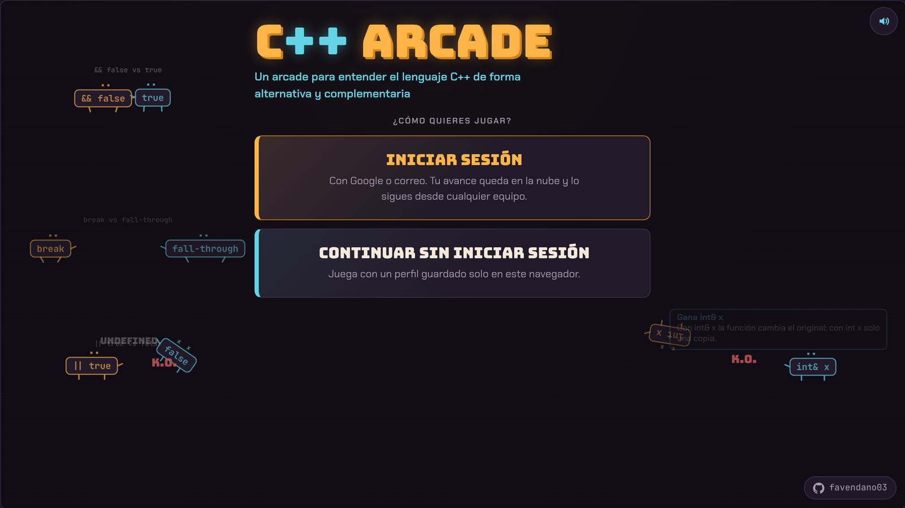
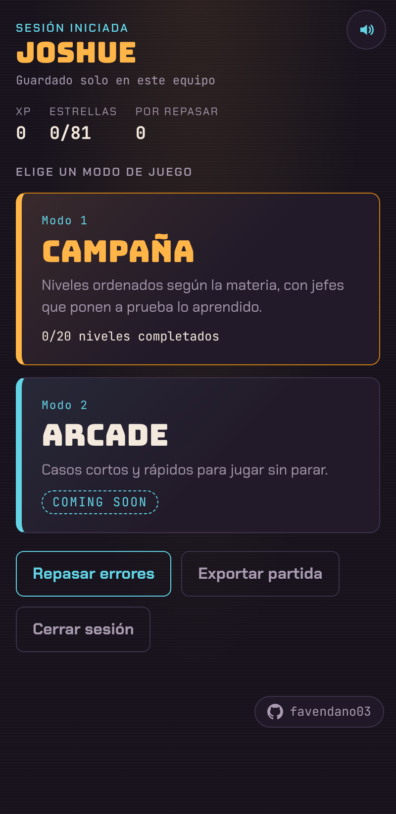
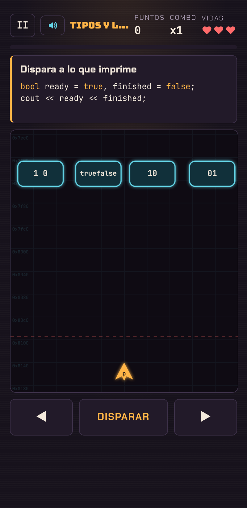
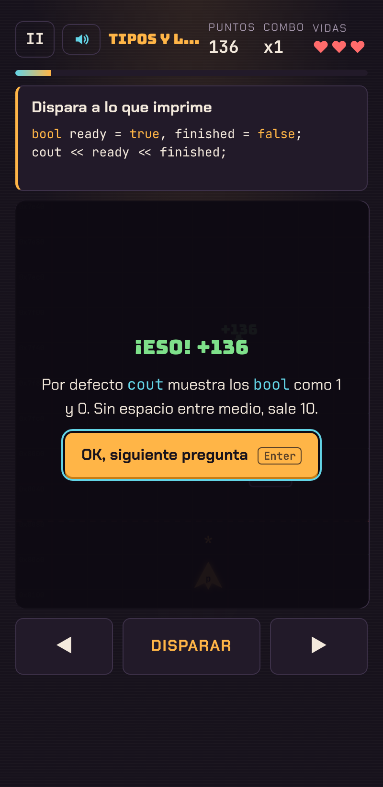

# C++ Arcade

**Un arcade para entender el lenguaje C++ de forma alternativa y complementaria.**

### [▶ Jugar en cpparcade.cl](https://cpparcade.cl)



<p align="center">
  
  
  
</p>

C++ Arcade enseña **conceptos** de C++, no a escribir código: qué hace el preprocesador, el compilador y el enlazador, cuánto mide cada tipo, qué pasa al pasar por valor o por referencia, cuándo una recursión se queda sin caso base, por qué `arr[10]` se sale de un arreglo de 10. Cada pregunta se responde jugando, y cada respuesta viene con una explicación corta.

Nació como herramienta de estudio para el curso *Programación en Finanzas* (C++), por eso varios ejemplos usan bonos y opciones.

## Cómo se juega

- **Campaña**: 16 niveles en 4 bloques, con un jefe al final de cada bloque.
  - **Estructuras y Funciones**: disponible.
  - **Gestión de memoria**: próximamente.
- **Arcade**: casos cortos y rápidos. Próximamente.

Hay tres mecánicas:

| Mecánica | Qué haces |
|---|---|
| **Clasificador** | Cae una pieza de código y la guías a la caja correcta (por ejemplo: ¿lo resuelve el preprocesador, el compilador o el enlazador?). |
| **Disparos** | Disparas a la respuesta correcta entre varias que bajan por la pantalla. |
| **Carrera** | Te cambias al carril de la respuesta correcta antes de chocar con las demás. |

Los jefes mezclan preguntas de todo su bloque y atacan de formas distintas. Las preguntas de punteros y de control de flujo se generan al azar, así que cada partida es distinta. Después de cada respuesta el juego se pausa con una explicación hasta que aprietas **OK**, y los errores quedan guardados en **Repasar errores**.

## Niveles de la campaña

| Bloque | Nivel | Mecánica |
|---|---|---|
| 1 · Bases | Estructura de un programa: preprocesador, compilador o enlazador | Clasificador |
| | Variables y ámbito | Carrera |
| | Tipos y literales (sizeof, rangos, octal, hex, binario) | Disparos |
| | Texto y constantes (char, escapes, string, const vs #define) | Carrera |
| | **Jefe: Overflow** | Jefe, ataque dirigido |
| 2 · Operadores y archivos | Operadores aritméticos y asignación | Carrera |
| | Lógica, bits, conversiones y precedencia | Disparos |
| | Entrada, salida y stringstream | Carrera |
| | Header y .cpp | Clasificador |
| | **Jefe: Undefined Reference** | Jefe, abanico |
| 3 · Funciones | Funciones: definición y llamadas | Carrera |
| | Paso por valor y por referencia | Disparos |
| | Interfaces: void, sobrecarga, defaults, prototipos, inline (¿compila?) | Clasificador |
| | Recursión | Carrera |
| | **Jefe: Stack Overflow** | Jefe, lluvia de marcos |
| 4 · Control y arreglos | Selección e iteración | Carrera |
| | Saltos y switch | Disparos |
| | Arreglos | Disparos |
| | Cadenas estilo C | Carrera |
| | **Jefe final: Segmentation Fault** | Jefe, ataques mixtos |

Los niveles normales están siempre abiertos, para estudiar el tema que quieras. Cada jefe se desbloquea al completar su bloque, y el final pide además vencer a los otros tres. Hay también dos secciones extra: **Memoria** (stack o heap, punteros, fugas de memoria) y **Clases** (diseño de una clase en `.h` y `.cpp`, vida de un objeto).

## Controles

- **Teclado**: `◀ ▶` o `A`/`D` para moverte, `▲ ▼` o `W`/`S` para avanzar y retroceder en la carrera, `Espacio` para soltar o disparar, `Enter` para cerrar una explicación, `Esc` o `P` para pausar, `M` para el sonido.
- **Celular**: botones en pantalla debajo del juego, y el parlante arriba a la derecha para el sonido.

## Tu avance

- **Con cuenta** (Google o correo): el avance se guarda en la nube y se sigue desde cualquier equipo. Al crear la cuenta puedes traer el avance de un perfil del navegador.
- **Sin cuenta**: perfiles guardados en el navegador, con PIN opcional. Para llevarlos a otro equipo está **Exportar partida** (código o archivo `.json`).

## Cómo está hecho

- **HTML, CSS y JavaScript puro**, sin frameworks ni compilación.
- **Canvas 2D** con tres motores de juego propios (clasificador, disparos y carrera) y jefes con patrones de ataque.
- **Web Audio**: todos los efectos de sonido se sintetizan en el navegador, sin archivos de audio.
- **Firebase Authentication y Firestore** para las cuentas. Las [reglas de seguridad](firestore.rules) dejan que cada jugador lea y escriba solo su propio documento y validan los campos que se guardan.
- **GitHub Pages** con dominio propio y diseño adaptado a celular.

```
index.html             pantallas (inicio, modos, juego, resultado, repaso)
css/style.css          estilos
js/questions.js        contenido de los niveles y generadores de preguntas
js/engines.js          motores de juego (clasificador, disparos, carrera, jefes)
js/app.js              navegación entre pantallas y controles
js/storage.js          perfiles locales, exportar e importar
js/cloud.js            cuentas en la nube (Firebase)
js/firebase-config.js  configuración pública del proyecto de Firebase
js/sound.js            efectos de sonido sintetizados
js/bg.js               duelos animados del menú de inicio
js/egg.js              animación sorpresa del título
js/audio-test.js       prueba de sonido (se abre con cpparcade.cl/#audio)
firestore.rules        reglas de seguridad de la base de datos
```

Para correrlo en tu computador basta un servidor estático, por ejemplo `python3 -m http.server` en esta carpeta, y abrir `http://localhost:8000`. Para agregar preguntas, edita `js/questions.js`.

## In English

**C++ Arcade** is a browser arcade game for learning C++ *concepts* (compilation stages, types and ranges, pass by value vs. reference, recursion, arrays) rather than syntax drills. A campaign of 16 levels and 4 bosses uses three mechanics (sort, shoot, lane runner), and every answer comes with a short explanation. Built with vanilla JavaScript and Canvas 2D, synthesized Web Audio sound effects, and Firebase Authentication + Firestore for cross-device progress. Play it at **[cpparcade.cl](https://cpparcade.cl)** (Spanish).

## Licencia

[MIT](LICENSE). El SDK de Firebase incluido en `js/vendor/firebase/` es Apache-2.0.
